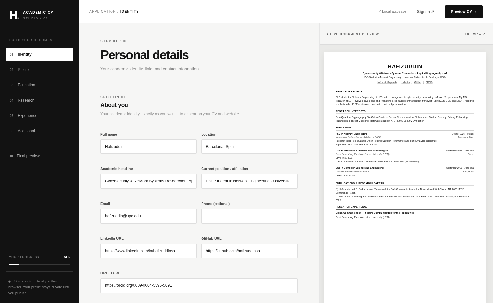

# Academic CV Studio — first prototype



`design-preview.html` is a static design example that can be opened in a browser. The actual editable application is `app/page.tsx`.

A minimal **black & white academic CV builder** made for PhD students and scholarship applications. Pre-filled with Hafizuddin's academic resume (uploaded November 2026). Built with **Next.js**, **Supabase**, and **Vercel**.

## What works

- Six editing steps: Identity, Profile, Education, Research & Papers, Experience & Projects, Skills & Awards.
- Existing resume details pre-filled; every text field is editable, and education / publications / positions / projects can be added or removed.
- Live academic CV preview with clean print styles.
- **Save as PDF**: opens browser print dialogue; select **Save as PDF**, A4, margins none/default as appropriate.
- Local autosave even without any accounts or database. Export your data as a JSON backup.
- Optional private cloud drafts and manually published profile links: `https://your-site.vercel.app/p/hafizuddin`.
- Optional AI rewriting: a short instruction in each step produces **three factual variants** that you can inspect and apply.
- Safe defaults: no phone or reference contact details are seeded into the public GitHub repository, and both are OFF in the public CV by default. Published snapshots omit these details unless explicitly enabled.

## Start locally (no setup required for demo mode)

Install Node.js 20+.

```bash
npm install
npm run dev
```

Open `http://localhost:3000`. You can complete all six steps, review the layout, and print/save a PDF **without** Supabase or OpenAI. In this demo mode, cloud publishing and AI rewrites are disabled until configured.

## Enable Supabase (cloud saving + public links)

1. Create a free Supabase project.
2. In Supabase **SQL Editor**, run `supabase/schema.sql`. This creates `cv_drafts` (private) and `cv_profiles` (public published snapshots) with row-level security.
3. In **Authentication → Providers**, ensure Email / OTP is enabled. Add `http://localhost:3000` and your deployed `https://YOUR-APP.vercel.app` URL to **Authentication → URL Configuration → Redirect URLs**. Set your deployed app as the Site URL.
4. Copy `.env.example` to `.env.local`. Set the Supabase project URL and **anon/publishable key** (NOT the service-role key).
5. Restart `npm run dev`, sign in with your email, save a draft, and publish your CV.

**Important: Personal owner-only site.** The provided SQL restricts owner access to `hafizuddin@upc.edu`, as written on the uploaded resume. Sign into Supabase with **that email**, or replace this address everywhere in `supabase/schema.sql` before running the SQL if you want a different sign-in email. Do not remove these checks unless you intentionally want a multi-user CV builder. AI also requires `AI_ALLOWED_EMAIL`.

### Supabase privacy notes

- Before publishing, CV drafts are only readable by their signed-in owner.
- Publishing creates a separate public snapshot; changing a draft **does not** change the live CV until you publish changes.
- You must deliberately click **Publish portfolio** to make a page publicly accessible.
- Everything intentionally published (including email) can be read by visitors, as expected for a public CV. Phone and references are omitted if their toggles are unchecked.
- The initial CV data, except private phone/reference details, is in `lib/cv.ts`; note that anything committed to a public GitHub repository is publicly visible.

## Enable AI writing assistance (optional)

Add these **server-side** variables to `.env.local` and to Vercel project settings:

```bash
OPENAI_API_KEY=sk-...       # do not commit
OPENAI_MODEL=gpt-4.1-mini
AI_ALLOWED_EMAIL=your-sign-in-email@domain.com
```

AI rewriting requires an active Supabase session, configured OpenAI API access and a matching `AI_ALLOWED_EMAIL`. Never expose the OpenAI key in the browser or put it in a `NEXT_PUBLIC_` variable. The rewriting service requests concise, academic, and impact-focused versions without inventing credentials. You should still verify every generated sentence.

## Publish to GitHub / Vercel

1. Create a new **private or public GitHub repository**, and upload all files from this folder (including `.gitignore` and `.env.example`; **not** `.env.local`).
2. Go to [vercel.com/new](https://vercel.com/new), import the GitHub repository, and keep Framework Preset = **Next.js**.
3. Deploy. If you want cloud features, add `NEXT_PUBLIC_SUPABASE_URL`, `NEXT_PUBLIC_SUPABASE_ANON_KEY` and the optional AI variables in **Vercel → Project → Settings → Environment Variables** and redeploy.
4. Add your actual Vercel URL in Supabase redirect settings. Use `/p/hafizuddin` once your profile is explicitly published.

## Project structure

```text
app/page.tsx               Six-step editor, live preview and publishing
app/p/[slug]/page.tsx      Shareable public academic CV
app/api/rewrite/route.ts    Server-side authenticated AI rewrite API
components/CVDocument.tsx  Print-ready CV template
components/PublicActions.tsx
lib/cv.ts                  Resume starter data and types
lib/supabase.ts            Supabase client
supabase/schema.sql        Database tables and RLS
app/globals.css            Minimal black and white styling
```

## Planned for the next iteration (not included in this prototype)

- Multiple CV templates (research grant, scholarship, industry resume)
- Cover letter generator
- Direct server-generated PDF download rather than browser Print → Save as PDF
- Per-application versions with version history
- Optional publications feed / project details pages

This is intentionally a reviewable first version, not a full SaaS product. Check the UI flow and section order before requesting changes.
