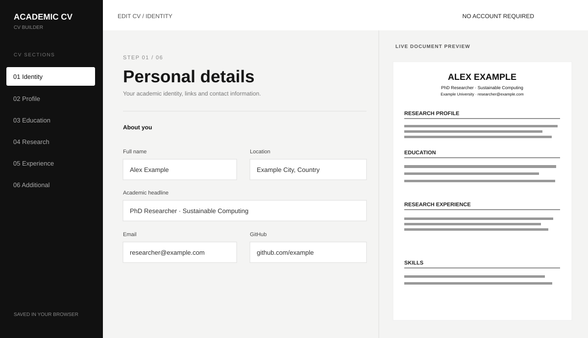

# Academic CV Builder

A simple CV editor for students and researchers applying for PhD positions, scholarships, and research jobs.

Add your details, review the layout, then save a PDF. There's no account to create.



## What it does

- Edit six sections: personal details, profile, education, research, experience, and other information.
- See the CV as you work.
- Print or save an A4 PDF.
- Keep a draft in your browser, with an option to export or import a JSON backup.
- Share a read-only copy using a link.
- Try simple text-formatting suggestions for written sections.

The starter CV uses fictional information. Replace or remove the example entries before sharing.

## Saving and sharing

Drafts are stored in your browser, not on a server. If you clear your browser data, your draft may be lost. Keep a JSON backup if you need one.

A shared link contains a copy of the CV. Anyone with the complete link can read it. Editing your draft won't update an old link, and links can't be revoked remotely.

## Development

Built with Next.js and React.

```bash
npm install
npm run dev
```

No database, login, or environment variables are required.

## License

MIT — see [LICENSE](LICENSE).
